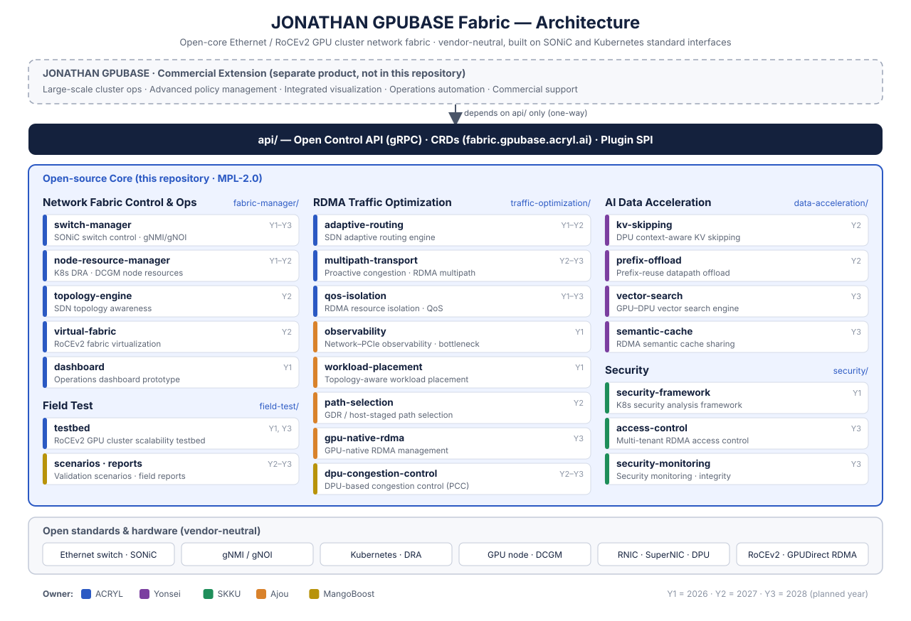
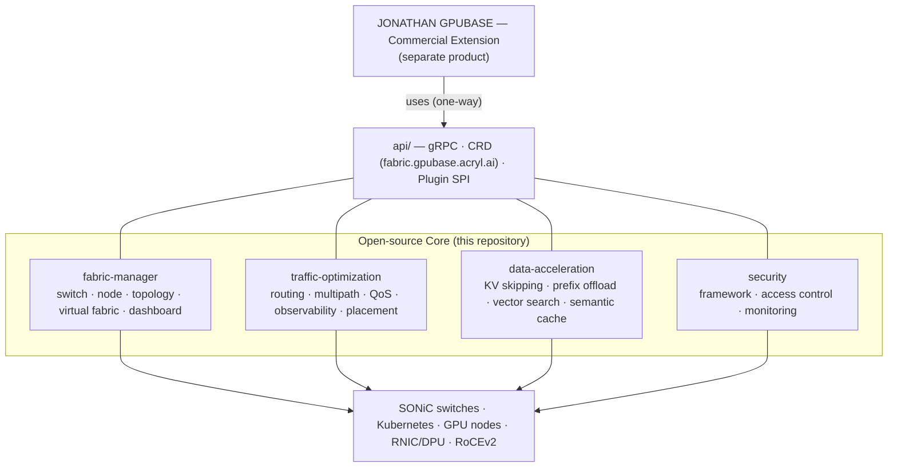
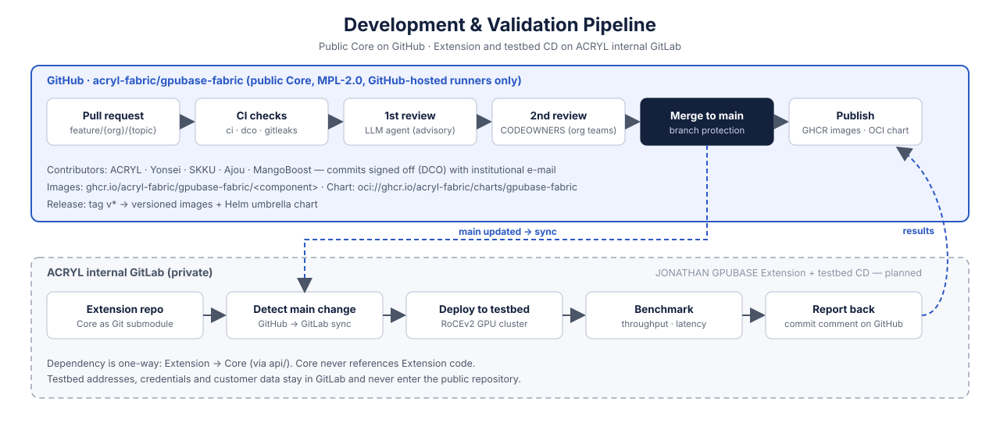

<p align="center">
  <a href="https://www.acryl.ai/"></a>
</p>

<h1 align="center">JONATHAN GPUBASE Fabric</h1>

<p align="center">
  <b>Open-core Ethernet / RoCEv2 network fabric manager for large-scale GPU clusters</b><br/>
  Topology awareness · switch &amp; node resource control · RDMA traffic optimization — on open standards, with no vendor lock-in.
</p>

<p align="center">
  <a href="LICENSE"></a>
  <a href="https://github.com/acryl-fabric/gpubase-fabric/actions/workflows/ci.yml"></a>
  
  
  
  
</p>

<p align="center">
  <a href="README_ko.md">한국어</a> ·
  <a href="#quick-start">Quick Start</a> ·
  <a href="#project-layout">Project Layout</a> ·
  <a href="CONTRIBUTING.md">Contributing</a> ·
  <a href="#open-core--enterprise">Enterprise</a>
</p>

<p align="center"><sub>Led and maintained by <a href="https://www.acryl.ai/"><b>ACRYL Inc.</b></a> with a consortium of Yonsei University, Sungkyunkwan University, Ajou University and MangoBoost.</sub></p>

---

## Overview

Training and serving large AI models depends on GPU-to-GPU communication. Today most GPU
cluster networks are built on InfiniBand with proprietary management software, which raises
cost and locks operators into one vendor. Ethernet with **RoCEv2** (RDMA over Converged
Ethernet v2) is the open alternative, but it lacks an integrated, GPU-aware way to operate the
fabric.

**JONATHAN GPUBASE Fabric** is that operating layer. It is a network fabric manager that brings
together, under one control plane:

- **Topology awareness**: automatic discovery of the physical and logical GPU cluster topology (SDN)
- **Switch and node resource control**: SONiC switches over gNMI/gNOI, and GPU/NIC node resources over Kubernetes DRA and DCGM
- **RDMA traffic optimization**: adaptive routing, proactive congestion control with multipath transport, RDMA resource isolation and QoS
- **Fabric virtualization**: per-tenant RoCEv2 overlays (VXLAN/GENEVE)
- **Observability**: network–PCIe observability, bottleneck classification and topology-aware workload placement
- **Data path acceleration and security**: DPU offloading for AI data paths, and multi-tenant RDMA security

> **Vendor neutral by design.** Every component is built on standard interfaces: SONiC, gNMI/gNOI,
> Kubernetes (DRA), DCGM and RoCEv2. No component depends on a specific switch, NIC, DPU or GPU
> vendor. Vendor-specific behavior goes behind the plugin SPI in [`api/`](api/README.md).

### Architecture

<p align="center">
  
</p>

<details>
<summary>Text version (Mermaid)</summary>



</details>

---

## Project Layout

The repository is a **polyglot monorepo** organized by **layer**, then by **component**. Each
organization picks the language of its components (Go, Python, C/C++, …). What every component
shares is the [component contract](docs/governance/COMPONENT_CONTRACT.md): a README, a Makefile
with `build`/`test`, and `tests/`. Deployable components also ship a `Dockerfile` and a Helm
`chart/`. Components never import each other; they integrate through [`api/`](api/README.md)
(gRPC/CRD) and share code through [`libs/`](libs/README.md).

```bash
gpubase-fabric
├── api/                      # public contracts: gRPC proto, CRDs, plugin SPI
├── fabric-manager/           # network fabric control & operations layer
├── traffic-optimization/     # RDMA traffic optimization layer
├── data-acceleration/        # AI data processing acceleration layer (DPU offload)
├── security/                 # security layer
├── field-test/               # testbed, validation scenarios, field-test reports
├── libs/                     # shared libraries per language (libs/go, libs/python, ...)
├── research/                 # paper reproduction & experiments (relaxed contract)
├── deploy/                   # Helm umbrella chart "gpubase-fabric"
├── hack/                     # dev scripts, component template, diagram generators
└── docs/                     # governance, guides, yearly deliverables, images
```

### Where to start

- **Install the fabric manager**: [Quick Start](#quick-start) and [`deploy/`](deploy/README.md)
- **Build a new component or bring existing code**: [`hack/new-component.sh`](hack/new-component.sh), the [component contract](docs/governance/COMPONENT_CONTRACT.md) and the [import guide](docs/guides/importing-existing-code.md)
- **Integrate or extend** (plugins, other projects, commercial extension): [`api/`](api/README.md) and the [JONATHAN GPUBASE integration guide](docs/guides/jonathan-gpubase-integration.md)
- **Yearly public deliverables**: [`docs/deliverables/`](docs/deliverables/2026/README.md)

### api [[View Details]](api/README.md)
Open control API and the only extension point of the Core: gRPC services, CRDs in the
`fabric.gpubase.acryl.ai` group, and a plugin SPI.

### fabric-manager [[View Details]](fabric-manager/README.md)
Controls and monitors the Ethernet fabric and GPU node resources through standard interfaces.

├── switch-manager [[View Details]](fabric-manager/switch-manager/README.md) — SONiC switch control and telemetry over gNMI/gNOI<br>
├── node-resource-manager [[View Details]](fabric-manager/node-resource-manager/README.md) — GPU/NIC node resources via Kubernetes DRA and DCGM<br>
├── topology-engine [[View Details]](fabric-manager/topology-engine/README.md) — SDN-based cluster topology awareness <i>(Y2)</i><br>
├── virtual-fabric [[View Details]](fabric-manager/virtual-fabric/README.md) — RoCEv2 fabric virtualization for multi-tenancy <i>(Y2)</i><br>
└── dashboard [[View Details]](fabric-manager/dashboard/README.md) — operations dashboard prototype (basic monitoring views)<br>

### traffic-optimization [[View Details]](traffic-optimization/README.md)
Improves RDMA transfer efficiency over RoCEv2.

├── adaptive-routing [[View Details]](traffic-optimization/adaptive-routing/README.md) — SDN adaptive routing across heterogeneous switches<br>
├── multipath-transport [[View Details]](traffic-optimization/multipath-transport/README.md) — proactive congestion detection and RDMA multipath <i>(Y2–Y3)</i><br>
├── qos-isolation [[View Details]](traffic-optimization/qos-isolation/README.md) — RDMA resource isolation and QoS policies<br>
├── observability [[View Details]](traffic-optimization/observability/README.md) — network–PCIe observability and bottleneck classification<br>
├── workload-placement [[View Details]](traffic-optimization/workload-placement/README.md) — topology-aware workload placement and re-placement<br>
├── path-selection [[View Details]](traffic-optimization/path-selection/README.md) — dynamic GDR / host-staged transfer path selection <i>(Y2)</i><br>
├── gpu-native-rdma [[View Details]](traffic-optimization/gpu-native-rdma/README.md) — GPU-native RDMA management system and library <i>(Y3)</i><br>
└── dpu-congestion-control [[View Details]](traffic-optimization/dpu-congestion-control/README.md) — DPU-based congestion control (PCC) API and library <i>(Y2–Y3)</i><br>

### data-acceleration [[View Details]](data-acceleration/README.md)
Reduces network traffic and redundant computation on the GPU–network data path through DPU offloading.

├── kv-skipping [[View Details]](data-acceleration/kv-skipping/README.md) — DPU-based context-aware KV skipping <i>(Y2)</i><br>
├── prefix-offload [[View Details]](data-acceleration/prefix-offload/README.md) — prefix-reuse data path offloading <i>(Y2)</i><br>
├── vector-search [[View Details]](data-acceleration/vector-search/README.md) — GPU–DPU cooperative vector search <i>(Y3)</i><br>
└── semantic-cache [[View Details]](data-acceleration/semantic-cache/README.md) — RDMA semantic cache sharing and redistribution <i>(Y3)</i><br>

### security [[View Details]](security/README.md)
Threat modeling, vulnerability validation and multi-tenant RDMA security for GPU clusters.

├── security-framework [[View Details]](security/security-framework/README.md) — Kubernetes-based security analysis environment<br>
├── access-control [[View Details]](security/access-control/README.md) — high-assurance RDMA access control engine <i>(Y3)</i><br>
└── security-monitoring [[View Details]](security/security-monitoring/README.md) — security monitoring and integrity UI <i>(Y3)</i><br>

### field-test [[View Details]](field-test/README.md)
├── testbed [[View Details]](field-test/testbed/README.md) — RoCEv2 GPU cluster scalability testbed<br>
├── scenarios [[View Details]](field-test/scenarios/README.md) — field-test requirements and validation scenarios <i>(Y2)</i><br>
└── reports [[View Details]](field-test/reports/README.md) — integrated fabric field-test reports <i>(Y3)</i><br>

### Development workflow

<p align="center">
  
</p>

Pull requests go through CI (`ci`, `dco`, `gitleaks`), an advisory LLM review, and a CODEOWNERS
review by the owning organization. Merged components are published to GHCR. The internal
testbed pipeline then deploys `main` to a real RoCEv2 GPU cluster and reports benchmark results
back to the commit. See [CI_CD.md](docs/governance/CI_CD.md).

---

## Quick Start

> **Status:** Year 1 (2026) is pre-alpha. Components are skeletons; interfaces in `api/` are `v1alpha1`.

```bash
# Install the umbrella chart from GHCR (available after the first tagged release)
helm install gpubase-fabric oci://ghcr.io/acryl-fabric/charts/gpubase-fabric \
  --namespace gpubase-fabric --create-namespace \
  --version <VERSION>

# Or install from source
git clone https://github.com/acryl-fabric/gpubase-fabric.git
cd gpubase-fabric
helm dependency update deploy/gpubase-fabric
helm install gpubase-fabric deploy/gpubase-fabric -n gpubase-fabric --create-namespace
```

Build and test everything locally:

```bash
make verify      # component contract and license header checks
make build test  # build and test every component
```

Requirements: Kubernetes with DRA enabled (1.34+ recommended) and Helm 3.8+ (OCI support).
Development toolchains differ per component; see each component README.

---

## Open Core & Enterprise

This repository is the **open-source Core** of JONATHAN GPUBASE Fabric: topology awareness,
control interfaces and basic traffic control, released under MPL-2.0.

**Large-scale cluster operations, advanced policy management, integrated visualization and
commercial technical support** are provided by **[JONATHAN GPUBASE](TODO_JONATHAN_URL)**, ACRYL's
commercial AI infrastructure platform. JONATHAN GPUBASE builds on this Core only through the
public interfaces in [`api/`](api/README.md); the Core never depends on it.

- How to use the Core with JONATHAN GPUBASE: [Integration guide](docs/guides/jonathan-gpubase-integration.md)
- Where the line between Core and Extension is drawn: [CORE_EXTENSION.md](docs/governance/CORE_EXTENSION.md)
- Commercial inquiries: [ACRYL Inc.](https://www.acryl.ai/)

---

## Media

<!-- Talks, articles, papers and demo videos will be listed here. -->
*Coming soon.*

## Consortium

| Organization | Role | Layer |
|---|---|---|
| **ACRYL Inc.** | Lead organization · maintainer | Fabric control & operations, RDMA traffic optimization, field test, integration |
| **Yonsei University** | Consortium member | AI data processing acceleration (DPU offloading) |
| **Sungkyunkwan University** | Consortium member | Security |
| **Ajou University** | Consortium member | Observability, workload placement, transfer path, GPU-native RDMA |
| **MangoBoost** | Consortium member | DPU congestion control, field test |

See [CONTRIBUTING.md](CONTRIBUTING.md) to contribute.

## License

JONATHAN GPUBASE Fabric is licensed under the [Mozilla Public License 2.0](LICENSE).
See [NOTICE](NOTICE) for attribution and [LICENSE_POLICY.md](docs/governance/LICENSE_POLICY.md)
for the dependency license policy.

## Trademarks

"JONATHAN", "GPUBASE" and "ACRYL" are trademarks of ACRYL Inc. The MPL-2.0 does not grant
trademark rights. See [TRADEMARKS.md](TRADEMARKS.md).

## Acknowledgement <a name="ack"></a>

This work was supported by [_Institute of Information & Communications Technology Planning & Evaluation (IITP)_](https://www.iitp.kr/) grant funded by the [_Ministry of Science and ICT (MSIT)_](https://www.msit.go.kr/), Republic of Korea (**No. RS-2026-25525457**, _Development of Ethernet Based GPU Cluster Network Fabric Systems and Optimization Technologies for Maximizing Network Efficiency in Large Scale Environments_).

---

<p align="center">
  <a href="https://www.acryl.ai/"></a>
  <a href="https://www.yonsei.ac.kr/"></a>
  <a href="https://www.skku.edu/"></a>
  <a href="https://www.ajou.ac.kr/"></a>
  <a href="https://www.mangoboost.io/"></a>
</p>
<p align="center">
  <a href="https://www.msit.go.kr/"></a>
  <a href="https://www.iitp.kr/"></a>
</p>
