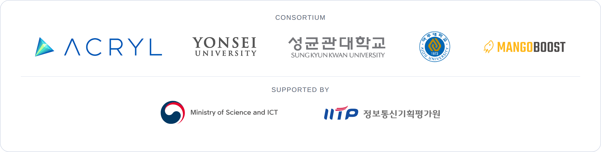

<p align="center"></p>

<h1 align="center">JONATHAN GPUBASE Fabric</h1>

<p align="center"><b>대규모 GPU 클러스터를 위한 이더넷(RoCEv2) 네트워크 패브릭 관리 오픈소스 Core</b><br/>
<a href="README.md">English</a> · <a href="CONTRIBUTING.md">기여 가이드</a></p>

<p align="center"><sub>주관·유지관리: <b>㈜아크릴(ACRYL Inc.)</b> · 공동연구: 연세대학교, 성균관대학교, 아주대학교 산학협력단, 망고부스트코리아</sub></p>

---

## 개요

대규모 AI 학습·추론 성능은 GPU 간 통신 성능에 크게 좌우됩니다. 현재 GPU 클러스터 네트워크는
InfiniBand 전용 장비와 관리 소프트웨어 중심이라 비용 부담이 크고 특정 벤더에 종속됩니다.
**JONATHAN GPUBASE Fabric**은 그 대안인 RoCEv2 기반 이더넷 GPU 클러스터를 위한 네트워크 패브릭
매니저입니다. 다음 기능을 하나의 관리 체계로 제공합니다.

- 토폴로지 자동 인식(SDN)
- 범용 스위치(SONiC, gNMI/gNOI)와 노드 자원(Kubernetes DRA, DCGM) 통합 제어
- RDMA 트래픽 최적화: 적응형 라우팅, 선행적 혼잡제어·다중경로, 자원 격리·QoS
- 패브릭 가상화, 관측·병목 분류, DPU 오프로딩 기반 데이터 경로 가속, 보안

> **벤더 중립**: SONiC·Kubernetes 등 표준 인터페이스만 사용하며 특정 벤더에 종속되지 않습니다.

<p align="center"></p>

## 저장소 구성

| 디렉터리 | 내용 | 담당 |
|---|---|---|
| [`api/`](api/README.md) | 공개 인터페이스(gRPC, CRD, 플러그인 SPI) | 아크릴 |
| [`fabric-manager/`](fabric-manager/README.md) | 네트워크 패브릭 제어·운영 계층 | 아크릴 |
| [`traffic-optimization/`](traffic-optimization/README.md) | RDMA 트래픽 전송 최적화 계층 | 아크릴·아주대·망고부스트 |
| [`data-acceleration/`](data-acceleration/README.md) | AI 데이터 처리 가속 계층 | 연세대 |
| [`security/`](security/README.md) | 보안 계층 | 성균관대 |
| [`field-test/`](field-test/README.md) | 테스트베드·실증 | 아크릴·망고부스트 |
| [`libs/`](libs/README.md) | 언어별 공용 라이브러리 (`libs/go`, `libs/python` …) | 아크릴 + 추가 기관 |
| [`research/`](research/README.md) | 논문 재현·실험 코드 | 기관 자율 |
| [`deploy/`](deploy/README.md) | 통합 Helm 차트 `gpubase-fabric` | 아크릴 |
| [`docs/`](docs/) | 거버넌스, 가이드, [연차별 공개 산출물](docs/deliverables/2026/README.md) | 아크릴 |

<p align="center"></p>

## 빠른 시작

```bash
helm install gpubase-fabric oci://ghcr.io/acryl-fabric/charts/gpubase-fabric \
  -n gpubase-fabric --create-namespace --version <VERSION>
```

1차년도(2026)는 pre-alpha 단계입니다. 컴포넌트는 골격 상태이며 `api/`는 `v1alpha1`입니다.

## 오픈 코어와 상용 제품

이 저장소는 오픈소스 Core(토폴로지 인식, 제어 인터페이스, 기본 트래픽 제어)입니다.
대규모 클러스터 운영, 고급 정책 관리, 통합 시각화, 운영 자동화, 상용 기술 지원은
**[JONATHAN GPUBASE](TODO_JONATHAN_URL)**에서 제공합니다.
연계 방법은 [JONATHAN GPUBASE 연계 활용 가이드](docs/guides/jonathan-gpubase-integration.md)를 참고하세요.

## 라이선스 · 상표

- 라이선스: [MPL-2.0](LICENSE) · [NOTICE](NOTICE)
- 상표: "JONATHAN", "GPUBASE", "ACRYL"은 ㈜아크릴의 상표입니다([TRADEMARKS.md](TRADEMARKS.md)).

## 사사

이 성과는 정부(과학기술정보통신부)의 재원으로 정보통신기획평가원의 지원을 받아 수행된 연구임
(**No. RS-2026-25525457**, 대규모 GPU 클러스터 환경에서의 네트워크 효율성 극대화 위한 이더넷 기반의
GPU 클러스터 네트워크 패브릭 시스템 및 최적화 기술 개발).

---

<p align="center">
  
</p>
